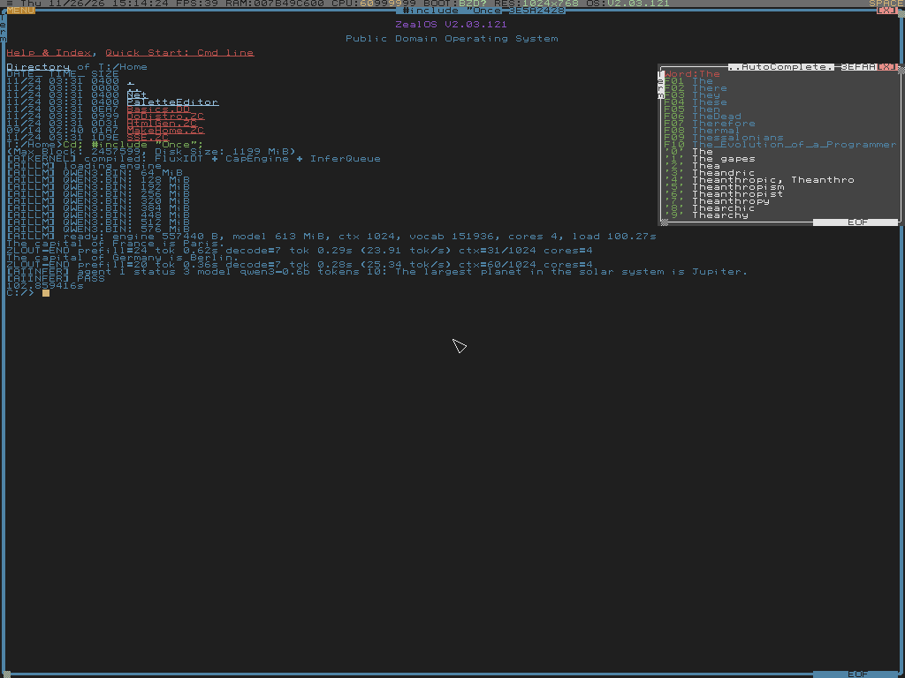

# ZealOS-AI

ZealOS with an LLM running in ring 0. You boot it and the OS answers questions. There is no Linux under it, no host doing the work, and no network call. The tokens come from the CPU, inside ZealOS.



Measured 2026-11-26 on QEMU KVM, Ryzen 9 9950X3D (single-core run shown; 4 cores do 25-32 tok/s):

```
[AILLM] ready: engine 552640 B, model 613 MiB, ctx 1024, vocab 151936, load 102.59s
The capital of France is Paris.
ZLOUT-END prefill=24 tok 1.34s decode=7 tok 1.88s (3.72 tok/s) ctx=31/1024
The capital of Germany is Berlin.          <- follow-up turn, same KV cache
ZLOUT-END prefill=20 tok 0.47s decode=7 tok 0.37s (18.96 tok/s) ctx=60/1024
```

This is a fork of [ZealOS](https://github.com/Zeal-Operating-System/ZealOS), which is itself a modernized fork of TempleOS. The upstream README is kept in [UPSTREAM-README.md](UPSTREAM-README.md).

## What works today

| piece | status |
|---|---|
| Qwen3-0.6B (Q8_0) inference in ring 0 | **works**: multi-turn chat with a retained KV cache, about 19 tok/s on one core |
| `AIAsk(prompt)` / `AIChat` from the ZealOS shell | **works** |
| Boot-to-answer autostart from the live ISO | **works**: the autostart mounts the AI-pack SATA disk and runs it |
| Answers mirrored to COM1 (`ZLOUT-BEGIN` / `ZLOUT-END`) | **works**: this is how CI and the host scripts verify a run |
| Multi-core inference | **works**: workers pinned to every core; 4 cores reach 25-32 tok/s |
| Agent inference through the kernel `InferQueue` | **works**: FluxIDT + CapEngine + InferQueue JIT-compile at boot (`AIKERNEL.ZC`); a capability-checked `InferSync` from agent 1 completes on the `LOCAL_CPU` backend |
| AgentForge / Syscall (need a rebuilt kernel) | source is in `src/Kernel`; the full fork-kernel build is not proven yet. The performance table in [ZEALOS-AI.md](ZEALOS-AI.md) is a design target, not a measurement |
| Bonsai 2.5 27B (ternary, `qwen35` hybrid architecture) | planned: needs a second engine |

## How it works

The engine is [llm.asm](https://github.com/alesha-pro/llm.asm)'s Qwen3 forward pass, written in pure x86-64 AVX2/FMA assembly. We wrap it as a flat, position-independent blob (`ENGINE.BIN`) with a HolyC calling convention, so ZealOS code calls it through plain function pointers. ZealOS never turns AVX on, so every entry point enables it (CR4.OSXSAVE plus XCR0) on whatever core it lands on.

`AILLM.ZC` is the HolyC side. It loads the engine and the model into memory, binds the entry points and streams tokens to the console. Everything is in [`aipack/`](aipack/README.md).

```
ZealOS shell / agent
   |  AIAsk("...")                       HolyC  (aipack/zealos/AILLM.ZC)
   v
ENGINE.BIN  ZlBegin -> ZlNext ... -> ZlEnd    x86-64 AVX2  (aipack/engine/zeal_glue.asm + llm.asm)
   |
   v
QWEN3.BIN  (.asmbin, 614 MiB, read from the FAT32 AI-pack disk)
```

## Try it

You need a Linux host with KVM, podman and QEMU, and a CPU with AVX2 + FMA + F16C.

```bash
bash aipack/host/fetch-and-export.sh          # Qwen3-0.6B -> .asmbin
bash aipack/host/z.sh engine                  # build ENGINE.BIN
bash aipack/host/z.sh disk                    # FAT32 AI-pack disk
bash aipack/host/z.sh iso                     # live ISO with the AI autostart
bash aipack/host/z.sh run @aipack/steps/proof.txt
```

The full walkthrough and the traps we hit are in [aipack/README.md](aipack/README.md).

## Roadmap

1. Spawn agents (AgentForge) on the same path once the fork kernel builds.
2. Run Bonsai 2.5 27B in ring 0, which needs a second engine for the `qwen35` architecture (Gated DeltaNet plus gated attention, Hadamard-rotated `PQ2_0` ternary weights, 8.3 GB).

## Credits and licences

- ZealOS / TempleOS: public domain (Unlicense). See [LICENSE](LICENSE).
- llm.asm: MIT, (c) alesha-pro. The engine sources are fetched at build time.
- Qwen3-0.6B: Apache-2.0, Qwen team. The weights are downloaded at build time and never committed.
- ZealOS-AI additions: Aitherium.
